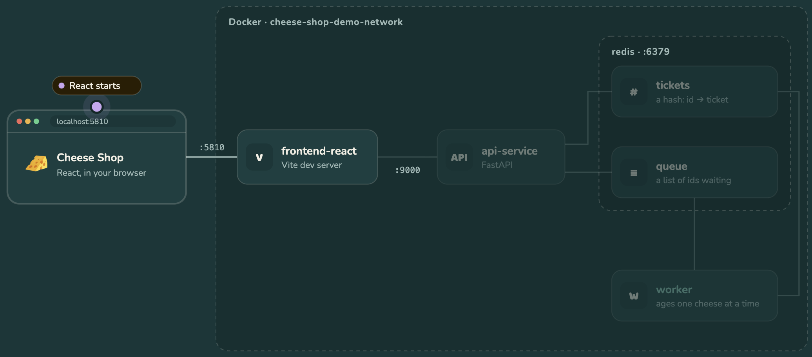

# Cheese Shop Demo

In this tutorial we run a small full-stack app on our laptop, in four containers on one Docker network.
You order cheeses, a worker ages them one at a time, and the page shows them moving across the board.



## Prerequisites
- Docker, with ports 5810 and 9810 free. Nothing else: no Python or Node on your laptop.
- For the Kubernetes tutorial: port 8080 free too, and about 2 GB of memory and 3 CPUs for Docker.

## Tutorial: Environment Setup

### Clone the GitHub repository
- Clone or download from [here](https://github.com/dlops-io/cheese-shop-demo)

## Tutorial: APIs & Frontend
We run a typical web app: a React frontend, a FastAPI backend, Redis for the data, and a worker for the
slow jobs.

### Start the shop
1. From the `cheese-shop-demo` folder, build and start all four containers:
```bash
cd src
```

```bash
docker compose up --build
```

The first run takes a few minutes to build the images.

2. When the log says `VITE ... ready`, open http://localhost:5810 and order some cheeses. Vite's log
   says 5173: that is the port inside the container.

3. Open the Network tab in your browser's developer tools. The page calls `/api/orders` twice a second
   and draws whatever comes back: it only shows the shop.

The page calls its own origin, and Vite forwards `/api` to `http://api-service:9000` (see
`vite.config.js`). `api-service` is the API's name on the Docker network, and 9000 is its port there.

### View API docs
FastAPI gives us interactive API documentation for free.
- Go to http://localhost:9810/api/docs
- Try these, in order:

| Call | What it shows |
| --- | --- |
| `POST /api/orders` with `{"count": 3}` | A JSON body goes in; `201` and three tickets come out |
| `GET /api/orders` | The tickets move from `queued` to `aging` to `ready` |
| `GET /api/orders/1` | A path parameter |
| `GET /api/orders/9999` | `404`: there is no such ticket |
| `POST /api/orders` with `{"count": 51}` | `422`: `Field(ge=1, le=50)` refused it before our code ran |

### Look inside Redis
1. In a new terminal, open Redis's command line:
```bash
docker exec -it cheese-shop-demo-redis redis-cli
```

2. Order 50 cheeses on the page, then ask Redis:
```
LLEN queue
HGET tickets 1
```

`LLEN` is how many tickets are waiting. `HGET` is one ticket, exactly as the API returns it.

3. Leave with `exit`, and restart the API from the `src` folder:
```bash
docker compose restart api-service
```

4. Reload the page: every ticket is still there. The API keeps nothing of its own, so it can restart,
   or run as many copies as we like. The Kubernetes tutorial relies on this.

### See why `await` matters
1. In `src/api-service/api/service.py`, add `import time` at the top, and this as the first line of
   `place_order`:
```python
    time.sleep(3)  # pretend to check the payment
```

2. Save, and the API reloads. Order a few cheeses. The whole page stops moving for 3 seconds:
   `time.sleep` holds up the API, so even `GET /api/orders` has to wait.

3. Add `import asyncio` at the top, and change the line to:
```python
    await asyncio.sleep(3)  # pretend to check the payment
```

4. Order again. Only your order waits, and the board keeps moving. `await` tells Python "do something
   else while this waits".

5. Take the line out again.

A slow call that cannot be awaited, such as a call to an LLM, goes in a plain `def` route instead:
FastAPI runs those in a thread, so one slow answer does not stop the API. The chat routes in
`cheese-app-v2` do this.

### Review the code
| File | What it does |
| --- | --- |
| `src/docker-compose.yml` | The four containers, and how they connect |
| `src/api-service/api/service.py` | The API: its routes, and the `Order` model that checks every order |
| `src/api-service/api/worker.py` | The worker: takes a ticket from the queue, ages the cheese, repeats |
| `src/frontend-react/vite.config.js` | Forwards `/api` to the API container |
| `src/frontend-react/src/api.js` | Every call to the API |
| `src/frontend-react/src/App.jsx` | Asks the API for the shop twice a second, and draws it |
| `src/frontend-react/src/OrderForm.jsx` | The order form |
| `src/frontend-react/src/Board.jsx` | The three columns of tickets |

`src/frontend-react/src/how-it-works/` draws the **How does it work?** section at the bottom of the
page. It only explains the app, so you can skip it when reading the code.

Run the tests and the frontend checks while the shop is running:
```bash
docker compose exec api-service pytest
```

```bash
docker compose exec frontend-react npm run check
```

## Tutorial: Scaling with Kubernetes
Our shop works, until many people order at once. We push it until it falls behind, then let Kubernetes
run it and add workers by itself.

### Set up, before class
This downloads images, so do it on a good connection. It takes a few minutes the first time.

1. From the `cheese-shop-demo` folder, open the deployment shell:
```bash
cd src/deployment
```

```bash
./docker-shell.sh
```

2. Inside the container, create the cluster and start the shop on it:
```bash
./scripts/create-cluster.sh
```

```bash
./scripts/deploy.sh
```

That makes a cluster of three nodes, each a Docker container on your laptop, and adds metrics-server,
which measures CPU. Then it builds the production images, copies them into the nodes and starts the
shop. Every `kubectl` command below runs in this shell. For a second one, run `./docker-shell.sh` again
from `src/deployment`.

### Overload the shop
1. With the shop from APIs & Frontend still running in docker compose, order 500 cheeses from the
   deployment shell:
```bash
./scripts/order.sh 500 http://localhost:5810
```

2. Watch http://localhost:5810. One worker ages one cheese every 1.5 s, so the last of the 500 is ready
   in about 12 minutes, and every new order waits behind them.

3. `docker compose up --scale worker=5` would help. But someone has to notice and type it, all five run
   on one machine, and a worker that crashes stays down.

4. Stop the compose shop: press Ctrl-C where `docker compose up` is running, then, from `src`:
```bash
docker compose down
```

### Run the shop on Kubernetes
1. Open http://localhost:8080. It is the same shop, from the same code, now in production images.

2. See what runs:
```bash
kubectl get deployments,pods
```

There are four Deployments, with one pod each: `frontend-react`, `api-service`, `redis` and `worker`.
A Deployment says what to run and how many copies, and Kubernetes keeps it that way. Read
`k8s/worker.yaml`.

3. Copy the worker's pod name from `kubectl get pods`, and delete it:
```bash
kubectl delete pod <worker-pod-name>
```

Run `kubectl get pods` again: a new worker is already starting. Kubernetes noticed one was missing
and replaced it. The old worker finished the cheese in its hands first, so nothing was lost.

4. Run three copies of the API:
```bash
kubectl scale deployment api-service --replicas=3
```

Order some cheeses. The board looks just as before, whichever copy answers. This is the restart from
APIs & Frontend paying off: the API keeps nothing, so any copy can answer any request.

### Let Kubernetes add workers
1. Turn on a HorizontalPodAutoscaler (HPA) for the worker:
```bash
kubectl apply -f k8s/hpa.yaml
```

Read `k8s/hpa.yaml`. The HPA reads each worker's CPU, and adds workers, up to 6, while they use more
than 60% of what they asked for.

2. In a second deployment shell, watch it, refreshed every 2 seconds:
```bash
watch -n 2 kubectl get hpa,pods
```

Wait for a number under `TARGETS`, such as `cpu: 1%/60%`. Until then the HPA has nothing to read.

3. Order 500 again:
```bash
./scripts/order.sh 500
```

4. Watch the workers and the board:

| | One worker in docker compose | Kubernetes with the HPA |
| --- | --- | --- |
| Workers | 1 | 1, then up to 6 |
| First new worker | Never | About 15 to 30 s after the order |
| All 500 ready | About 12.5 minutes | About 2.5 minutes |
| Afterwards | 1 worker | Back to 1 worker, about 4 minutes after the order |

Nobody typed a command, and the extra workers went away when the work did. The HPA only sees CPU, so
it is always a little late: a queue of 500 and a queue of 5 look the same to it once the workers are
busy. Scaling on the length of the queue itself is the next step, with a tool such as KEDA.

### Clean up
Delete the cluster, in the deployment shell:
```bash
./scripts/delete-cluster.sh
```

Leave the container with `exit`.

To rehearse this tutorial before class, run `./scripts/verify.sh` in the deployment shell. It **deletes
the cluster**, builds a new one, runs every step above except the compose one, checks each result and
prints the numbers. It takes about 10 minutes.

## Troubleshooting

| What you see | What to do |
| --- | --- |
| `port is already allocated` | Another container is using port 5810 or 9810. Stop it, or run `docker ps` to find it |
| `The container name ... is already in use` | A container from an earlier run is still there. Run `docker ps -a` to find it, then `docker rm -f` it |
| The page says `The API answered 500` | Redis is not running. Run `docker compose up -d redis` in `src` |
| Tickets stay in **Queued** | The worker is not running. Run `docker compose ps` in `src` to check, or `kubectl get pods` on the cluster |
| `port is already allocated` when creating the cluster | Something is using port 8080. Stop it, or run `docker ps` to find it |
| `TARGETS` shows `<unknown>` | Wait up to a minute for the HPA's first reading |
| The worker jumps to 5 pods as soon as you apply the HPA | Its first reading still includes your last order. Wait for it to go back to one pod |

## Docker Cleanup

Press Ctrl-C where `docker compose up` is running, then, from `src`:
```bash
docker compose down
```

If you made the cluster, delete it from the deployment shell with `./scripts/delete-cluster.sh`.

The next command removes images and containers you are not using, across all your projects, so check
the list it shows you first:
```bash
docker system prune
```
